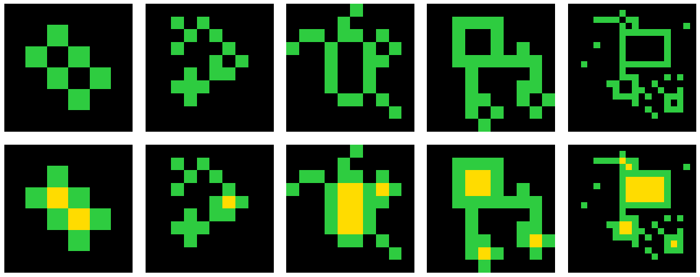

# rStar-ARC

**Tree-search program synthesis for ARC**

Bachelor's thesis · Pierre Roth · 2025

Language models build Python solutions step by step, guided by execution feedback
and a learned reward model. Search traces train the policy and reward models.
The implementation includes beam search, MCTS, bootstrapping, and task augmentation.



This research project is complete.

The recorded policy experiments show a generalization gap: the 3B model reached
14.4% training and 3% validation pass@128 in the [July notes](docs/research-notes.md#week-19-07072025).
A final measurement of the reward model's contribution is not recorded there.

## Run

Python 3.12. Search inference requires Linux and an NVIDIA GPU for vLLM.

```bash
python3.12 -m venv .venv
source .venv/bin/activate
pip install -r requirements/research.txt
python -m rstar_deepthink --config-file configs/search/beam.yaml
```

For CPU tests and visualization, install `requirements/core.txt` instead.

```bash
python -m rstar_deepthink.demo
python -m pytest -q
```

The demo checks three handwritten programs on a bundled task and writes an
interactive tree to `artifacts/demo/tree.html`. It needs no model or GPU.
Hover for code; hold Shift for search metadata.

## Layout

| Directory | Contents |
| --- | --- |
| [`rstar_deepthink/`](rstar_deepthink/) | Solver, agents, models, and training pipelines |
| [`configs/`](configs/) | Search and ablation experiments |
| [`data/`](data/) | Sample tasks, prompt examples, and bootstrap descriptions |
| [`scripts/`](scripts/) | Inference, adapter merging, and SLURM submission |
| [`tests/`](tests/) | CPU tests |
| [`docs/`](docs/) | [Research notes](docs/research-notes.md), figures, and [sources](docs/sources.md) |

See the [training guide](rstar_deepthink/training/README.md) for entry points.
Imported ARC helpers are separated under `rstar_deepthink/vendor/`.
`python -m scripts.submit` submits jobs to the ETH TIK cluster.

## Data and storage

Trained checkpoints, generated datasets, and full experiment outputs are not
included. Generated files default to `artifacts/`.

| Variable | Default |
| --- | --- |
| `RSTAR_STORAGE_DIR` | `<checkout>/artifacts` |
| `RSTAR_SCRATCH_DIR` | `<storage>/scratch` |
| `RSTAR_DATA_DIR` | `<storage>/task_data` |

Fine-tuned configurations expect models under `<storage>/models/policy/` and
`<storage>/models/reward/`. YAML paths are relative to the checkout.

## License

Original code: [MIT](LICENSE). [Third-party sources and terms](docs/sources.md).
